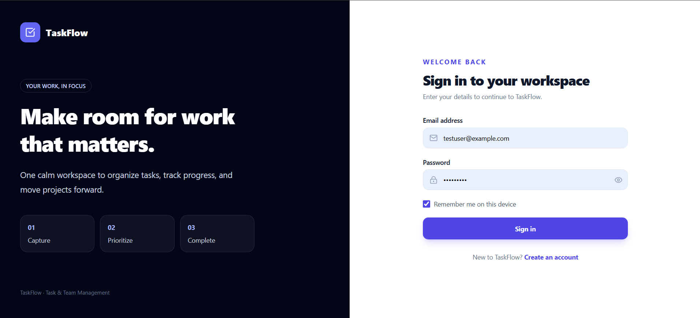
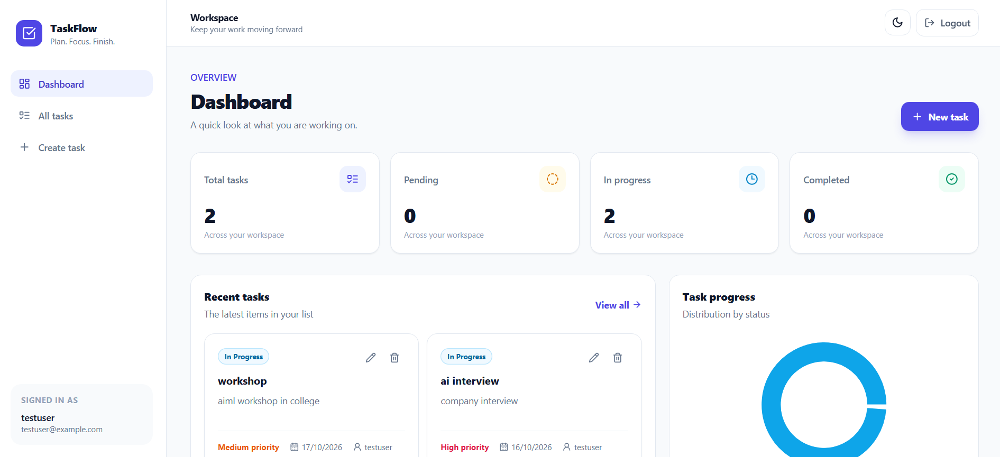
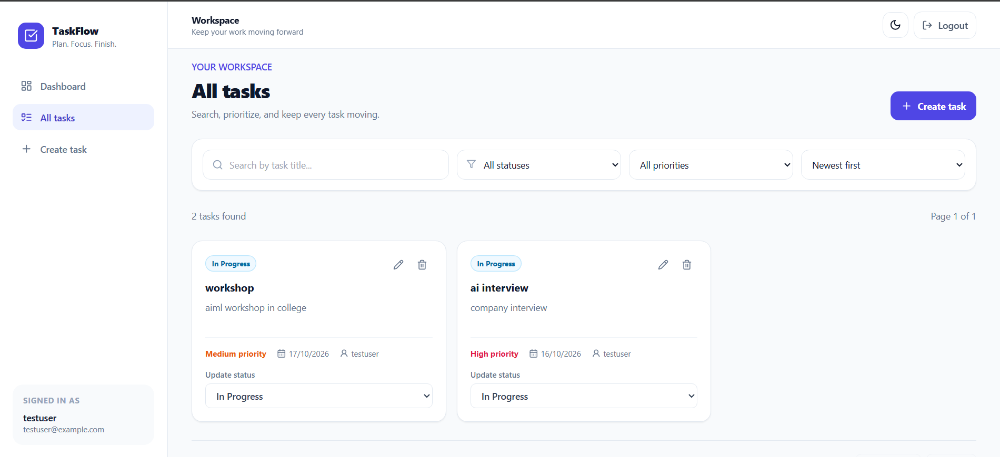

# Task Management Platform

A full-stack web application to manage tasks in one place. Users can create tasks, update their status, set priorities and due dates, and track their progress from the dashboard.

## Live Demo

- **Frontend:** https://task-management-platform-clientside.vercel.app/
- **Backend:** https://task-management-platform-serverside.onrender.com
- **GitHub Repository:** https://github.com/PrasadSanap/Task-Management-Platform

## Features

- User registration and login using JWT authentication
- Protected pages and API routes
- Create, view, update, and delete tasks
- Set task priority, status, due date, and assigned user
- Search and filter tasks
- Sort tasks by date
- Dashboard showing task statistics
- Pagination for the task list
- Dark mode and toast notifications
- Form validation and error messages
- Password hashing using bcrypt
- Backend unit tests

## Tech Stack

**Frontend**
- React and Vite
- React Router
- Redux Toolkit
- Axios
- Tailwind CSS

**Backend**
- Node.js
- Express.js
- MongoDB Atlas
- Mongoose
- JSON Web Tokens (JWT)
- bcrypt

## Getting Started

### Prerequisites

Install the following before running the project:

- Node.js and npm
- A MongoDB Atlas account or a local MongoDB instance
- Git

### 1. Clone the repository

```bash
git clone https://github.com/PrasadSanap/Task-Management-Platform.git
cd Task-Management-Platform
```


### 2. Set up the backend

Open a terminal:

```bash
cd server
npm install
```


Create a `.env` file inside the `server` folder:

```env
PORT=5000
MONGODB_URI=your_mongodb_connection_string
JWT_SECRET=your_long_random_secret
CLIENT_URL=http://localhost:5173
NODE_ENV=development
```


Start the backend:

```bash
npm start
```


The backend should run at `http://localhost:5000`.

### 3. Set up the frontend

Open another terminal from the project root:

```bash
cd client
npm install
```

Create a `.env` file inside the `client` folder:

```env
VITE_API_URL=http://localhost:5000/api
```

Start the frontend:

```bash
npm run dev
```


Open `http://localhost:5173` in your browser.

## API Documentation

The API base URL for local development is:

`http://localhost:5000/api`

### Authentication

| Method | Endpoint | Description |
|---|---|---|
| POST | `/auth/register` | Register a new user |
| POST | `/auth/login` | Log in and receive an authentication token |
| GET | `/auth/me` | Get the currently authenticated user's details |

### Tasks

| Method | Endpoint | Description |
|---|---|---|
| GET | `/tasks` | Get tasks for the authenticated user |
| GET | `/tasks/:id` | Get a task by ID |
| POST | `/tasks` | Create a task |
| PUT | `/tasks/:id` | Update a task |
| DELETE | `/tasks/:id` | Delete a task |

Task listing supports search, filtering, sorting, and pagination through query parameters implemented by the backend.

### Example: Register

**Request**

`POST /api/auth/register`

```json
{
  "name": "Test User",
  "email": "testuser@example.com",
  "password": "Test@1234"
}
```


The request fields must match the validation rules in the application. A successful registration creates a user account.

### Example: Login

**Request**

`POST /api/auth/login`

```json
{
  "email": "testuser@example.com",
  "password": "Test@1234"
}
```

On successful login, the API returns an authentication token and user information. Use the token for protected requests as required by the API.

### Example: Create a task

**Request**

`POST /api/tasks`

Include the JWT in the request header:

```http
Authorization: Bearer YOUR_JWT_TOKEN
```

Example request body:

```json
{
  "title": "Complete assignment",
  "description": "Finish and test the task management project",
  "priority": "High",
  "status": "Pending",
  "dueDate": "2026-11-15"
}
```

Use the field values accepted by the application's task validation. The authenticated user must be authorized to create or modify the requested resource.

### Error handling

The API returns appropriate HTTP status codes for common situations:

- `400` — Invalid request or validation error
- `401` — Missing or invalid authentication
- `404` — Requested resource not found
- `500` — Unexpected server error

## Database

The application uses MongoDB with Mongoose models.

- **User:** Stores user account information, including a hashed password.
- **Task:** Stores task details such as title, description, status, priority, due date, and user references.

Tasks are associated with users so that users can access only the data they are authorized to view or modify.

## React Concepts Used

The frontend uses React concepts required for the application:

- `useState` and `useEffect` for state and side effects
- `useMemo` and `useCallback` for performance-related optimizations
- `React.memo` to avoid unnecessary component renders where appropriate
- Custom hooks for reusable logic
- Redux Toolkit for shared application state
- Lazy loading and `Suspense` for loading components

## Folder Structure


```text
task-team-management-platform/
├── client/
│   ├── public/
│   ├── src/
│   │   ├── components/
│   │   ├── hooks/
│   │   ├── pages/
│   │   ├── services/
│   │   ├── store/
│   │   ├── App.jsx
│   │   └── main.jsx
│   ├── package.json
│   └── vite.config.js
│
├── server/
│   ├── config/
│   ├── controllers/
│   ├── middleware/
│   ├── models/
│   ├── routes/
│   ├── tests/
│   ├── package.json
│   └── server.js
│
├── screenshots/
│   ├── login.png
│   ├── dashboard.png
│   └── tasks.png
│
├── .gitignore
└── README.md
```

## Testing

To run the backend tests:

```bash
cd server
npm test
```

The backend test suite can be used to check supported API and application behaviour.

The API can also be tested using Postman. The collection used for testing can be included in the repository or submitted separately.

## Screenshots

### Login Page



### Dashboard



### Task Management



## Deployment

The frontend is deployed on Vercel and the backend on Render. MongoDB Atlas is used for the database.

For deployment, configure the environment variables in the hosting platforms:

**Frontend — Vercel**

```env
VITE_API_URL=https://task-management-platform-serverside.onrender.com/api
```

**Backend — Render**

```env
MONGODB_URI=your_mongodb_connection_string
JWT_SECRET=your_long_random_secret
JWT_EXPIRES_IN=7d
CLIENT_URL=http://localhost:5173
```

## Test Login Credentials

Provide working credentials for the deployed application before submission.

- **Email:** testuser@example.com
- **Password:** Test@1234

Make sure the account exists in the deployed database and can log in successfully. Do not use these placeholder values as submission credentials unless you have created that account.

## Author

**Prasad Sanap**

GitHub: https://github.com/PrasadSanap


